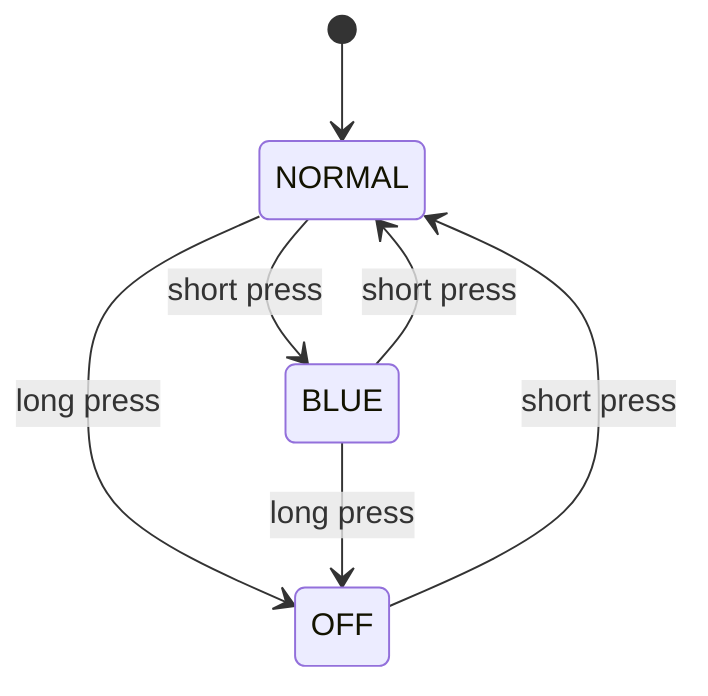
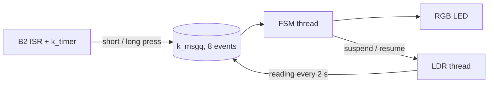

# Brightness Control (Zephyr RTOS on Nucleo-WL55JC)

**Subject:** Embedded Platforms and Communication for IoT, MIoT (UPM)  
**Authors:** David Suárez, David Márquez

## 1. Summary

An RGB LED shows the ambient light measured by an LDR, and the user changes the
operating mode with button **B2**. The application runs on **Zephyr RTOS** on a
**Nucleo-WL55JC** board (STM32WL55JC) and follows an event-driven design: producers
(button, LDR) post events to a message queue and a state machine thread consumes them.

| | |
| :--- | :--- |
| Board | NUCLEO-WL55JC (STM32WL55JC), schematic MB1389 |
| Zephyr / SDK | Zephyr 4.5 / Zephyr SDK 1.0.1 |
| Build system | `west` |
| Console | LPUART1 over the ST-LINK virtual COM port, 115200 8N1 |

## 2. Requirements and where they are implemented

| Requirement | Implementation | File |
| :--- | :--- | :--- |
| NORMAL and BLUE modes, state machine | `fsm_mode_t`, `enter_mode()`, `handle_event()` | `src/fsm.c` |
| Short press of B2 switches NORMAL / BLUE | `EVENT_BUTTON_SHORT_PRESS` | `src/button_service.c`, `src/fsm.c` |
| Brightness measured every 2 s with the ADC | Periodic LDR thread | `src/ldr_service.c` |
| RED < 33 %, YELLOW 33-66 %, GREEN > 66 % | `color_from_raw()` | `src/fsm.c` |
| Percentage relative to the full-scale range | `ADC_FULL_SCALE` (4095, 12 bit) | `src/events.h`, `src/ldr_service.c` |
| BLUE: LED stays blue, ADC acquisition suspended | `ldr_service_suspend()` | `src/fsm.c`, `src/ldr_service.c` |
| Serial output of mode and ADC readings | `printk` | `src/fsm.c` |
| Extra threads, one source file each | FSM thread, LDR thread | `src/fsm.c`, `src/ldr_service.c` |
| Long press (>= 1 s) enters OFF, fired at 1 s without waiting for release | `k_timer` | `src/button_service.c` |
| Long press does not generate a short press on release | `is_long_press_handled` flag | `src/button_service.c` |
| OFF: LED off, ADC suspended, "System OFF" printed | `enter_mode(FSM_MODE_OFF)` | `src/fsm.c` |
| Short press in OFF returns to NORMAL | `handle_event()` | `src/fsm.c` |
| Git with regular, meaningful commits | See section 10 | |

## 3. Hardware

### 3.1 Pin summary

| Function | MCU pin | Board label |
| :--- | :--- | :--- |
| Button B2 | PA1 | ST morpho CN10 pin 36 |
| RGB LED, red | PB3 | ARDUINO D3 |
| RGB LED, green | PB4 | ARDUINO A3 |
| RGB LED, blue | PB8 | ARDUINO D5 |
| LDR divider supply | PB12 | ARDUINO D2 |
| LDR divider output | PB1 (ADC1_IN5) | ARDUINO A0 |
| Console | PA2 / PA3 (LPUART1) | ST-LINK virtual COM port |

Source: UM2592 (STM32WL Nucleo-64 board MB1389), sections 6.6.2, 6.6.5 and 7.4.
The on-board user LEDs (PB15, PB9, PB11) are not used.

### 3.2 Common anode RGB LED

The LED is connected to 3.3 V (common anode), so the logic is inverted: a low level
turns a colour on and a high level turns it off. Devicetree declares the pins as
`GPIO_ACTIVE_LOW`, so the code works with logical values (1 = on).

| Channel | Pin | Devicetree alias | Series resistor |
| :--- | :--- | :--- | :--- |
| Red | PB3 | `led-red` | 1000 ohm |
| Green | PB4 | `led-green` | 1500 ohm |
| Blue | PB8 | `led-blue` | 1000 ohm |

Yellow is produced by turning red and green on together. When the LED is off, all
three pins are high and no current flows.

### 3.3 LDR light sensor

Photoresistor module marked HW-483 V0.2: the LDR forms a voltage divider with a fixed
resistor of 10 kOhm. The divider is powered from a GPIO pin instead of 3.3 V, so it only
draws current during a measurement, and the divider current is far below what a GPIO
pin can source.

| Signal | Pin | Devicetree | Notes |
| :--- | :--- | :--- | :--- |
| Divider output | PB1 (A0), ADC1 channel 5 | `analog-in-pin` (`zephyr,user`) | 12 bit, gain 1, internal reference |
| Divider supply | PB12 (D2) | `ldr-pwr` | Active high, on only during each conversion |

The ADC range is 0 to 4095. The brightness percentage is `raw * 100 / 4095`.

### 3.4 Button B2

B2 is wired to PA1 (`user_button_2` in the board devicetree, aliased as `sw0` in our
overlay). The devicetree declares it as `GPIO_ACTIVE_LOW | GPIO_PULL_UP`
(`gpios = <&gpioa 1 0x11>`): the MCU internal pull-up is enabled and a press pulls the
line low, which the driver reports as logical 1.

**Hardware debouncing circuit.** On sheet 4 of the MB1389 schematic ("User buttons"),
B2 is connected as follows:

- the push button (KMR231GLFS) connects a node to ground;
- a 100 nF capacitor (C69) connects that node to ground;
- an ESDALC6V1-1U2 protection diode (U13) connects that node to ground;
- a 1 kOhm resistor (R22) connects that node to PA1.

No other resistor appears on this net, so there is no external pull-up: the idle level
comes from the MCU internal pull-up, which is why the devicetree must enable
`GPIO_PULL_UP`.

When the button is pressed, the contact discharges C69 quickly. When it is released, or
when the contacts bounce open, C69 recharges through the internal pull-up and R22, so the
voltage rises with a time constant of (R_pullup + 1 kOhm) x 100 nF. With an internal
pull-up of tens of kOhm (for example 40 kOhm; check the datasheet for the exact value)
this is in the order of a few milliseconds, which absorbs contact bounce before the input
threshold is crossed. The 1 kOhm resistor and the diode protect the pin. Interrupts are
handled on both edges and no software debounce is used. In testing, repeatedly pressing B2 produced no spurious or double mode changes, so no software debounce was needed.
## 4. Operation

### 4.1 State machine



| Mode | LED | ADC acquisition | Serial output |
| :--- | :--- | :--- | :--- |
| NORMAL | Red / yellow / green by brightness | Every 2 s | `Mode: NORMAL`, then `ADC raw: <n>, brightness: <p>%` per reading |
| BLUE | Blue | Suspended | `Mode: BLUE` |
| OFF | Off | Suspended | `System OFF` |

Rules:
- A short press in NORMAL goes to BLUE. In BLUE or OFF it goes to NORMAL.
- A long press goes to OFF from NORMAL or BLUE. In OFF it is ignored.
- ADC readings only affect the LED in NORMAL.
- On returning to NORMAL, the LED immediately shows the colour of the last reading and
  a new reading is taken right away. At boot the LED starts red (no reading yet) until
  the first measurement, a few milliseconds later.

### 4.2 LED thresholds

The colour is classified from the raw value, not from the truncated percentage, so the
limits are exact:

- RED: `raw * 100 < 33 * 4095`
- YELLOW: `raw * 100 <= 66 * 4095`
- GREEN: otherwise

### 4.3 Expected serial output

```
Brightness control: events initialized
Brightness control started
Mode: NORMAL
LDR acquisition resumed
ADC raw: 2151, brightness: 52%
Mode: BLUE
LDR acquisition suspended
Mode: NORMAL
LDR acquisition resumed
System OFF
```

## 5. Software architecture

### 5.1 Components



| Element | Type | Priority | Blocks on |
| :--- | :--- | :--- | :--- |
| FSM (`fsm.c`) | Thread, 1024 B stack | 5 | `k_msgq_get(K_FOREVER)` |
| LDR (`ldr_service.c`) | Thread, 1024 B stack | 7 | Semaphore while suspended, `k_msleep` between readings |
| Button (`button_service.c`) | GPIO ISR + `k_timer` | n/a | Not a thread |
| `main` | Initialises and returns | default | n/a |

### 5.2 Events

All producers send an `event_t` (type, raw ADC value, brightness percentage) through
`events_send()`, and the FSM reads it with `events_receive()`. Event types:
`EVENT_BUTTON_SHORT_PRESS`, `EVENT_BUTTON_LONG_PRESS` and `EVENT_ADC_READING`. The header
`src/events.h` is the contract between the modules, so each one can be developed
independently.

### 5.3 Design decisions

- **Two threads.** The FSM must react to the user at any moment, while the sensor loop
  sleeps most of the time. Separating them keeps button response independent of ADC
  timing. The button needs no thread: an ISR and a timer detect the press length without
  polling.
- **Priorities.** The FSM (5) preempts the LDR thread (7), so a button press is never
  delayed by a measurement.
- **`k_msgq` with 8 events.** Producers never block (`K_NO_WAIT`), which is required in
  ISR context. Only the LDR thread produces periodic events and the FSM drains them in
  milliseconds, so 8 slots absorb bursts at about 64 bytes of RAM. If the queue is full,
  the event is dropped and a message is printed.
- **Flag and semaphore to suspend the LDR thread.** Using `k_thread_suspend()` from the
  FSM can stop the thread mid-conversion with the sensor unpowered, and it would send a
  false reading on resume. Here the thread blocks only at a safe point of its loop, and
  it is the only code that touches the supply pin.
- **Long press.** A 1 s `k_timer` posts the event when the threshold is reached, without
  waiting for release. A flag prevents the short-press event on release.
- **Fixed period.** The LDR thread computes the next wake-up from an absolute time, so
  the 2 s period does not drift by the duration of each reading.

## 6. Power management

### 6.1 Measures taken

- Threads block instead of polling: the FSM waits on the queue and the LDR thread
  sleeps, so the CPU idles between events.
- The LDR divider is powered from a GPIO only during each conversion, and it is switched
  off on every path, including errors.
- The sensor settling time uses `k_msleep()`, not a busy wait.
- The LED is off in OFF mode and the ADC is suspended in BLUE and OFF.
- `CONFIG_PM` is enabled. The system timer is LPTIM1 clocked from the LSI at 32 kHz
  (tickless kernel), so timeouts keep running in STOP modes.

### 6.2 Investigation: STOP states and the ADC

The board defines three STOP states: STOP0, STOP1 and STOP2 (devicetree `substate-id`
1, 2 and 3; minimum residency 100, 500 and 900 us). We tested which ones are compatible
with the ADC:

| Configuration | Result |
| :--- | :--- |
| PM on, no state lock | An ADC conversion never completes |
| Lock only during each measurement, all STOP states otherwise allowed | First reading works, the next conversion hangs |
| Same, without `CONFIG_PM_DEVICE_RUNTIME` and `CONFIG_PM_DEVICE` | Same failure |
| State lock held permanently | Works (no STOP at all) |
| STOP2 blocked, STOP0 and STOP1 allowed | Works |

According to the reference manual (RM0453, section 6.5.9), non-retained registers are
reset on wake-up from STOP2. We did not identify which ADC register or clock is lost,
but the failure only appears when STOP2 is allowed. The CPU does wake up correctly (the
thread resumes), so the cause is not a missing wake-up source, and the LDR supply pin is
not involved: GPIO outputs keep their state in STOP2.

### 6.3 Final configuration

- STOP2 is blocked at start-up (`src/main.c`).
- A PM state lock prevents any STOP state during each acquisition (`src/ldr_service.c`).
- `confs/prj_nucleo_wl55jc.conf` enables `CONFIG_PM`, `CONFIG_PM_DEVICE` and
  `CONFIG_PM_DEVICE_RUNTIME`.

Current consumption was not measured. It can be measured by removing jumper JP1 (ISoC)
and placing an ammeter in its place (UM2592, section 6.6.4).

## 7. Repository structure

```
.
├── CMakeLists.txt
├── boards/nucleo_wl55jc.overlay   # LED, LDR supply, ADC channel, B2 alias
├── confs/prj_nucleo_wl55jc.conf   # Kconfig options
└── src/
    ├── main.c                     # Initialisation, STOP2 lock
    ├── events.c / events.h        # Event queue and shared types
    ├── fsm.c / fsm.h              # State machine thread
    ├── ldr_service.c / .h         # LDR thread, ADC, supply pin
    ├── button_service.c / .h      # B2 interrupt and long-press timer
    └── led.c / led.h              # RGB LED driver
```

## 8. Build, flash and run

### Prerequisites
- Zephyr 4.5 and Zephyr SDK 1.0.1, with `west` configured ([installation guide](https://docs.zephyrproject.org/latest/develop/getting_started/index.html))
- STM32CubeProgrammer ([download](https://www.st.com/en/development-tools/stm32cubeprog.html))
- A serial terminal

### Build

```bash
west build -p always -b nucleo_wl55jc -- \
  -DDTC_OVERLAY_FILE=boards/nucleo_wl55jc.overlay \
  -DCONF_FILE=confs/prj_nucleo_wl55jc.conf
```

The VS Code tasks used during development are local (the `.vscode` folder is not part
of the repository), so the commands above are the reference.

### Flash

```bash
west flash
```

### Serial terminal (115200 8N1)

- macOS: `screen /dev/tty.usbmodem<id> 115200` (list the port with `ls /dev/tty.usbmodem*`)
- Linux: `screen /dev/ttyACM0 115200`
- Windows: `plink -serial COM7 -sercfg 115200,8,n,1,N`

## 9. Testing

| Test | Expected result |
| :--- | :--- |
| Cover and uncover the LDR | RED, YELLOW and GREEN according to the brightness |
| Short press in NORMAL | BLUE, no readings are printed |
| Short press in BLUE | NORMAL, last colour restored, new reading right away |
| Hold B2 for 1 s | `System OFF` when the second is reached, without releasing |
| Release after a long press | No short-press event |
| Short press in OFF | Back to NORMAL |
| Leave running for several minutes | A reading every 2 s, no missing output |

## 10. Git workflow

- Work was split by module: David Suárez developed the button and the LDR thread; David
  Márquez developed the state machine and the RGB LED.
- Features were developed on separate branches (`feature/...`, `fix/...`) and merged into
  `main` through pull requests with a merge commit.
- Commit messages follow `type: description` in English (`feat`, `fix`, `docs`, `chore`),
  one logical change per commit.

## 11. Known limitations

- Consumption was not measured.
- The LPTIM runs from the LSI, an internal RC oscillator, so the 2 s period is not
  crystal accurate.
- Only STOP0 and STOP1 are used between readings; STOP2 is disabled because of the ADC.
- The LDR response depends on the divider resistor chosen.

## 12. References

- [Zephyr documentation for the Nucleo WL55JC](https://docs.zephyrproject.org/latest/boards/st/nucleo_wl55jc/doc/nucleo_wl55jc.html)
- [Zephyr system power management](https://docs.zephyrproject.org/latest/services/pm/system.html)
- UM2592, STM32WL Nucleo-64 board (MB1389) user manual, and the MB1389 schematic
- RM0453, STM32WL5x reference manual (STMicroelectronics)
